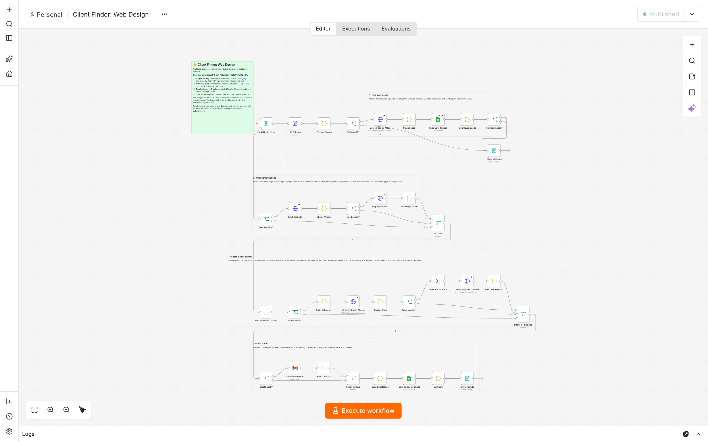
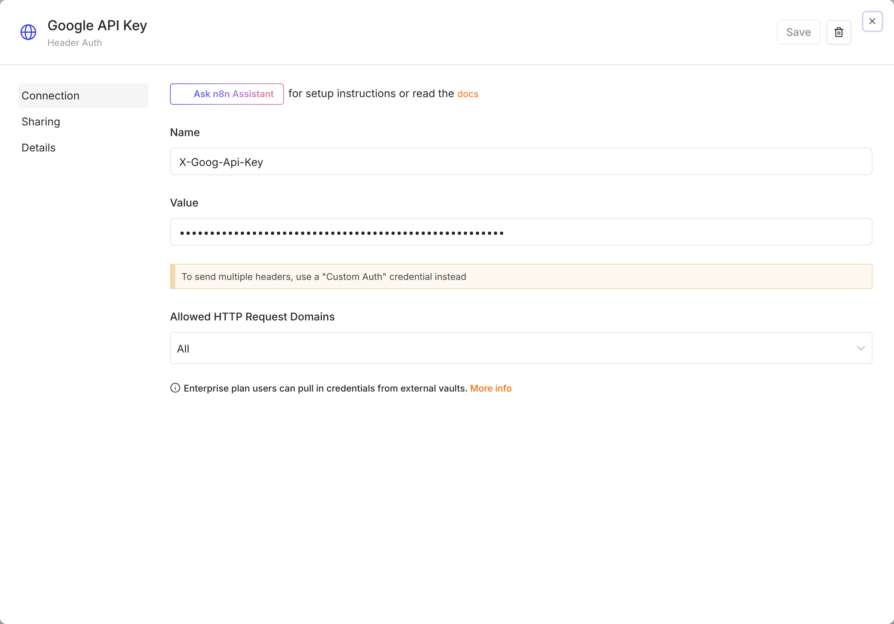
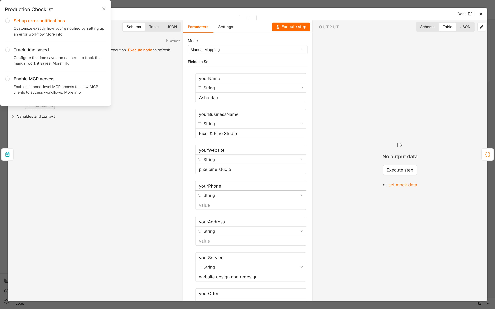
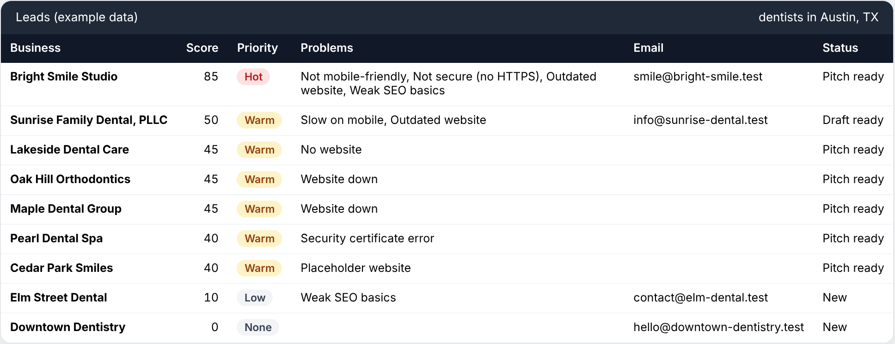

## Before you read

This guide sets up the paid Client Finder workflow, `client-finder-web-design.json`. The first setup takes about 30-45 minutes.

**Pro buyers:** the steps are the same for all five niche workflows. Only the checks and the default service and offer change, and three niches (Google Reviews, Social Media & Ads, AI Chatbots & Booking) have no PageSpeed nodes. Set up one workflow with this guide, then use PRO-GUIDE.pdf for the other niches and the Follow-up Autopilot.

Four words you will see often:

- **n8n** is the automation tool that runs the workflow.
- A **workflow** is a chain of small steps called **nodes**. Each node does one job.
- An **API key** is a password that lets n8n use a service, such as Google Maps, for you.
- A **credential** is a key or login that n8n stores safely and reuses.

## How it works

You type a business type and a city into a form, for example `dentists` and `Austin, TX`. The workflow does the rest. Node names are in *italics*.

*The web-design workflow after import. The notes on the canvas explain each stage.*

### 1. Read the form and your settings

*Find Clients Form* receives your search. *⚙️ Settings* adds your name, offer and sheet address. *Prepare Search* checks them. If something is missing, *Settings OK?* sends the run to *Show Message*, which tells you what to fix.

### 2. Find businesses on Google Maps

*Search Google Maps* asks Google's official Places API, with your own API key, for matching businesses. It is not a scraper. The search includes service-area businesses without a storefront, such as plumbers, cleaners and mobile trades. Google returns up to 20 per request and at most 60 per search. *Clean Leads* removes duplicates and closed businesses.

### 3. Skip businesses you already have

*Read Saved Leads* reads your Google Sheet. *Skip Saved Leads* removes every business already there, using Google's unique **Place ID**.

### 4. Check each website

*Has Website?* separates businesses with a website of their own from those with none. A Google link to a Facebook, Instagram, booking, ordering, delivery or directory page (for example StyleSeat, Toast, DoorDash, Yell or a WhatsApp link) counts as no website. Hosted sites such as square.site or Google Sites do count as their own website.

*Fetch Website* opens each homepage like a browser (20-second limit, up to 10 redirects). *Check Website* reads it: did it load, does it fit phones, what year is in the footer, is there a public email? If the domain forwards to a Facebook or booking page, it also counts as no website.

If a site fails to load (Web Design only), *Recheck Needed?* sends it to *Wait Before Recheck* (15 seconds), then *Fetch Website Again* and *Recheck Website* try once more. *Checked* joins the results. Only a failure seen twice counts. *Run PageSpeed?* sends sites that loaded, and sites with a certificate error, to *PageSpeed Test*. It runs Google's mobile speed test in real Chrome, which also confirms (or not) a certificate error. *Read PageSpeed* reads the scores. *All Leads* joins everything together.

### 5. Find problems and score each lead

*Find Problems & Score* runs the checks below. Each proven problem adds points. It also makes sure nobody is pitched twice: a lead whose email address or website is already in your sheet, or on a higher-ranked lead in the same search (chain locations, duplicate listings), is saved but not pitched again. *Worth a Pitch?* decides which leads get a pitch.

### 6. Write a pitch with Claude

*Build AI Request* prepares a message for Claude (Anthropic's AI model) with only verified facts: name, category, address, rating, reviews, website and the problems with their evidence, plus your name, business, service and offer. *Write Pitch with Claude* returns an email subject and body, a short DM (direct message) and a call opener. It sends 3 requests at a time, every 4 seconds. If Claude is busy, *Wait Before Retry* waits 15 seconds and *Retry Pitch with Claude* tries once more. If that fails, a ready-made template pitch is used. The template starts "I was looking at how *business* shows up online, and one thing stood out:" and then quotes the top problem's evidence, addressed to them ("your homepage...").

### 7. Save to your sheet

*Recheck Sheet* reads your sheet again just before saving, so a business another run saved in the meantime is skipped: no duplicate rows or drafts. *Build Sheet Rows* puts the best leads first. *Anything to Save?* stops with "Nothing new this time" if nothing is left. *Save to Google Sheet* adds the rows to the **Leads** tab. Leads that will get a draft are saved as **Draft ready**.

### 8. Create Gmail drafts and report

*Create Draft?* checks that there is a public email, a pitch, and drafts are turned on. *Create Gmail Draft* saves the email in Gmail **Drafts**. **Nothing is ever sent.** You review and send every email yourself. *Read Draft IDs* and *Save Draft IDs* write each draft's **Draft ID** and **Thread ID** back to its row. If Gmail refuses a draft, the row goes back to **Pitch ready** with a note. *Saved* joins everything, *Summary* counts it, and *Show Results* shows a summary in your browser.

### The web-design checks

| Check | Points | When it counts | Example evidence |
|---|---|---|---|
| No website | 45 | Google Maps lists no website, or only a social media, booking, ordering or directory page (or a domain that forwards to one) | "No website is listed on their Google Business Profile, so people who find them on Maps have nowhere to learn more or book." |
| Website down | 45 | The site fails to load twice, 15 seconds apart: the domain doesn't resolve, the server refuses the connection, no answer in 20 seconds, "not found" (404 or 410) or a server error. A dead link that isn't the homepage is reported as **Broken website link**, with the exact link. Temporary DNS errors, dropped connections and redirect loops are never claimed. | "...didn't load in two checks a few seconds apart: the domain doesn't resolve (it may have expired)." |
| Security certificate error | 40 | Chrome, in Google's PageSpeed test, also refuses the certificate, or it is expired, issued for another domain or self-signed | "...has an expired security certificate, so browsers show visitors a "Your connection is not private" warning instead of the site." |
| Placeholder website | 40 | Only a "coming soon", parked or default page, clear from the title, main heading or a nearly empty page. Nothing else is judged on it. | "...only shows a placeholder page ("coming soon", parked or default server page), not a real website." |
| Slow on mobile | 30 | Google's PageSpeed mobile test scores the homepage below 45/100 (a margin under Google's 50 line, because scores vary a little between runs) | "In Google's PageSpeed mobile test (a simulated phone on a 4G connection) the homepage scored 31/100 and the main content took 6.8 s to appear." |
| Not mobile-friendly | 30 | No mobile **viewport** (the code that fits a page to a phone screen) | "...isn't set up for phones (no mobile viewport), so it shows as a shrunken desktop page on mobile." |
| Not secure (no HTTPS) | 25 | The page finally loads on an `http://` address, without **HTTPS** (the secure, padlock address) | "...loads without HTTPS, so Chrome marks it "Not secure" next to the address." |
| Outdated website | 20 | The footer year is 3 or more years old (ranges like "© 2008-24" are read correctly) | "The footer of their homepage still shows © 2019, which suggests the site hasn't been updated in about 7 years." |
| Weak SEO basics | 10 | Google's Lighthouse SEO test (basic search-friendliness) scores below 80, or no page title, meta description (the summary Google shows in results) or main heading | "Google's Lighthouse SEO check scores the homepage 72/100..." |

Where Google's Lighthouse test (part of PageSpeed) and our reading of the page code disagree about the page title, meta description or viewport, Lighthouse wins.

> **Example:** The evidence above is example data from our made-up test businesses.

### Scores and priorities

The score is the sum of the points, up to 100. Each lead then gets a priority:

| Priority | Score | What it usually means |
|---|---|---|
| **Hot** | 60-100 | Several clear problems. Contact first. |
| **Warm** | 30-59 | One serious problem or a few smaller ones |
| **Low** | 1-29 | Small problems; no pitch by default |
| **None** | 0 | No problem found |

> **Example:** In our test data, Bright Smile Studio is not mobile-friendly (30), not secure (25), outdated (20) and has weak SEO basics (10): 85 points, **Hot**. Sunrise Family Dental in Austin, TX is slow on mobile (30) and outdated (20): 50 points, **Warm**.

Only verified evidence counts. If a website blocks automated visits, shows a bot check, is built entirely by JavaScript or redirects with a meta refresh, its page checks are skipped instead of guessed, and the **Notes** column says why. Such a lead may score 0. The checks are careful, but not perfect: read every draft before you send it.

> **Important:** Emails come only from what a business publishes on its homepage, and many publish none. Those leads still get a DM message and a call opener. An address on the business's own domain comes first, then free-mail addresses such as Gmail. Addresses in a "Website by…" credit, form placeholders and platform support addresses are never used.

## Before you start

### Accounts you need

| You need | Why | Notes |
|---|---|---|
| **n8n** (Cloud or self-hosted, version 1.123 or newer) | Runs the workflow | Works on n8n 1.x and 2.x. |
| A **Google account** | Google Cloud project, API key, Google Sheets | Any Gmail or Google Workspace account. |
| An **Anthropic account** | Claude writes the pitches | A Claude.ai chat plan does not include API credits. |
| A **Gmail or Google Workspace inbox** | Drafts are saved here; you send from here | Use the inbox you want replies in. |
| A payment card | Google Cloud billing and Anthropic credits | See the costs below. |

### Running costs

You pay each service directly for what you use.

| Service | What it costs | Notes |
|---|---|---|
| Google Places API (New) | Free monthly usage, then pay as you go | One request returns up to 20 businesses, so a 60-business search is 3 requests. Prices change: check https://mapsplatform.google.com/pricing/ |
| PageSpeed Insights API | Free | The default limit is 25,000 tests per day. |
| Claude (Anthropic) | Roughly 1-2 US cents per pitch with the default model | Only leads at or above **minScoreToPitch** go to Claude. Cheaper models cost less. |
| n8n | Your n8n plan | Each search is one workflow run (an *execution*), including test runs. Self-hosted n8n is free software; you pay for the server. |
| Google Sheets and Gmail | Free | Included with your Google account. |

> **Cost:** For example, if 10 leads get a pitch, Claude costs roughly 10-20 US cents, plus up to 3 Places requests.

## Step 1: Set up Google Cloud

### 1.1 Create a project

1. Go to `console.cloud.google.com` and sign in.
2. Click the project picker at the top, then **New Project**.
3. Name it `Client Finder`, click **Create**, and check it is selected at the top.

### 1.2 Turn on billing and set a budget alert

Google requires billing for Maps services, even inside the free monthly usage.

1. Open the menu (three lines, top left) and click **Billing**.
2. Click **Link a billing account** (or **Create billing account**) and add your card.
3. Open **Budgets & alerts** and click **Create budget**.
4. Choose a small amount, for example 10 in your currency, and click **Finish**.

> **Warning:** A budget alert only emails you; it does not stop spending. For a hard limit, lower the daily quota of Places API (New) in **APIs & Services**.

### 1.3 Enable the two APIs

1. Open the menu and go to **APIs & Services** > **Library**.
2. Search for `Places API (New)`, open it and click **Enable**.
3. Do the same for `PageSpeed Insights API`.

> **Warning:** Google also lists an older "Places API" without "(New)". You need **Places API (New)**.

### 1.4 Create and restrict the API key

1. Go to **APIs & Services** > **Credentials**.
2. Click **Create credentials** > **API key**. Copy the key for Step 5.
3. Click the key's name to open its settings.
4. Under **Application restrictions**, choose **None**. n8n runs on a server, so website or app restrictions would block it.
5. Under **API restrictions**, choose **Restrict key**. Tick **Places API (New)** and **PageSpeed Insights API**, then click **OK**.
6. Click **Save**. Changes can take a few minutes to work.

These are two different settings. **Application restrictions** decide *where* the key may be used from: keep it **None**. **API restrictions** decide *which APIs* the key may call: tick both APIs. The workflow's error messages tell you which one to fix.

> **Warning:** Treat the key like a password. If it leaks, delete it on the **Credentials** page and create a new one.

## Step 2: Get your Anthropic API key

1. Go to `console.anthropic.com` and create an account or sign in. The page may move you to a newer Anthropic address; that is fine.
2. Open **API keys** and click **Create key**.
3. Name it `Client Finder` and click **Create**.
4. Copy the key now. It starts with `sk-ant-`. Anthropic shows it only once.
5. Open **Billing** and buy prepaid credits. A small amount, for example 5-10 US dollars, is enough to start.

> **Tip:** New Anthropic accounts start with lower usage limits. Anthropic raises them over time as you buy more credits. The workflow sends Claude only 3 requests every 4 seconds, which suits new accounts.

## Step 3: Create your CRM sheet

A **CRM** is a list of contacts and where each one stands. `Client-Finder-CRM.xlsx` is your template, with three tabs: **Leads**, **Pipeline** (live counts) and **How to use**.

### Option A: Upload to Google Drive

1. Go to `drive.google.com` with the Google account you will connect to n8n.
2. Click **New** > **File upload** and choose `Client-Finder-CRM.xlsx`.
3. Double-click the file to open it.
4. Click **File** > **Save as Google Sheets**. A new tab opens with a real Google Sheet.

### Option B: Import into a new sheet

1. Go to `sheets.google.com` and open a blank spreadsheet.
2. Click **File** > **Import** > **Upload** and choose `Client-Finder-CRM.xlsx`.
3. Choose **Replace spreadsheet** and click **Import data**.

### After either option

Check that the first tab is called **Leads**. Copy the full address from your browser's address bar (it starts with `https://docs.google.com/spreadsheets/d/`) for Step 6.

> **Important:** Keep the tab name **Leads** and the header row exactly as they are. You may add your own columns to the right of **Notes**.

> **Warning:** In Option A, use the new Google Sheet, not the uploaded .xlsx file. If the title shows an **XLSX** label, you are still in the Excel file.

## Step 4: Import the workflow

1. In n8n, go to your **Workflows** list.
2. Click **Create Workflow** (in some versions **Create** > **Workflow**, or **+**). An empty canvas opens.
3. Open the workflow menu, the **...** button (next to the workflow name in n8n 2.x, at the top right in n8n 1.x), and choose **Import from File...**.
4. Select `client-finder-web-design.json`. Pro buyers find it in the `workflows` folder.
5. Click **Save**.

> **Important:** Import each file only once: two copies share one form address. Upgrading from Starter to Pro? Keep your Starter workflow and skip the Pro copy of `client-finder-web-design.json`.

## Step 5: Add the four credentials

| Credential (name it) | n8n type | Exact settings | Nodes that use it |
|---|---|---|---|
| Google API Key | **Header Auth** | **Name**: `X-Goog-Api-Key`. **Value**: your Google key. | *Search Google Maps*, *PageSpeed Test* (Web Design and Local SEO only) |
| Anthropic API Key | **Header Auth** | **Name**: `x-api-key`. **Value**: your key (starts with `sk-ant-`). | *Write Pitch with Claude*, *Retry Pitch with Claude* |
| Google Sheets account | **Google Sheets OAuth2 API** | **Sign in with Google** (Cloud), or your own Client ID and Secret (self-hosted, 5.4) | All 4 Google Sheets nodes: *Read Saved Leads*, *Recheck Sheet*, *Save to Google Sheet*, *Save Draft IDs* |
| Gmail account | **Gmail OAuth2 API** | Same as Google Sheets | The 1 Gmail node: *Create Gmail Draft* |

A **header** is a hidden label sent with each request; Google and Anthropic look for your key under these names.

### 5.1 Google API Key

1. Double-click *Search Google Maps*.
2. Leave **Authentication** (**Generic Credential Type**) and **Generic Auth Type** (**Header Auth**) as they are.
3. Open **Credential for Header Auth** and choose **Create new credential**.
4. In **Name**, type `X-Goog-Api-Key`. In **Value**, paste your Google key with no spaces.
5. Click the dialog title, rename it `Google API Key`, and click **Save**.
6. Open *PageSpeed Test* and choose **Google API Key** there too. (The Reviews, Social Media & Ads and AI Chatbots & Booking workflows have no *PageSpeed Test* node: skip this.)

*A Header Auth credential: Name is the header name, Value is your key.*

### 5.2 Anthropic API Key

1. Double-click *Write Pitch with Claude*. In **Credential for Header Auth**, choose **Create new credential**.
2. In **Name**, type `x-api-key` (lower case). In **Value**, paste your `sk-ant-` key.
3. Rename it `Anthropic API Key` and click **Save**.
4. Open *Retry Pitch with Claude* and choose **Anthropic API Key** there too.

> **Warning:** Both keys use the same credential type. Do not mix them up: Claude nodes need **Anthropic API Key**, Google nodes need **Google API Key**.

### 5.3 Google Sheets and Gmail on n8n Cloud

1. Double-click *Read Saved Leads*. In **Credential to connect with**, choose **Create new credential**.
2. Click **Sign in with Google**, choose the account that owns your sheet and allow access. Click **Save**.
3. Choose the same credential on the other three Google Sheets nodes: *Recheck Sheet*, *Save to Google Sheet* and *Save Draft IDs*.
4. On *Create Gmail Draft*, create a credential the same way with the inbox you send from.

> **Tip:** Leave the document and sheet fields in the Google Sheets nodes alone. They read your sheet address from *⚙️ Settings*.

### 5.4 Google Sheets and Gmail on self-hosted n8n

Self-hosted n8n needs your own Google login app, called an **OAuth client**. Both credentials can share it.

**A. Enable two more APIs.** In Google Cloud, go to **APIs & Services** > **Library**. Enable **Google Sheets API** and **Gmail API** in your Client Finder project.

**B. Set up the consent screen** (the page Google shows when you sign in).

1. Go to **APIs & Services** > **OAuth consent screen** (Google may call it **Google Auth Platform**). Click **Get started** if you see it.
2. Enter an app name, such as `Client Finder`, and your email.
3. For **Audience** (or **User type**), choose **External**.
4. Finish the remaining screens and click **Create**.
5. Under **Audience** > **Test users**, click **Add users**, enter your own Gmail address and save.

**C. Create the OAuth client.**

1. In n8n, create a new credential on *Read Saved Leads* and copy the **OAuth Redirect URL** it shows (like `https://your-n8n-address/rest/oauth2-credential/callback`).
2. In Google Cloud, go to **Clients** (or **Credentials** > **Create credentials** > **OAuth client ID**).
3. For **Application type**, choose **Web application**.
4. Under **Authorized redirect URIs**, click **Add URI** and paste the n8n address exactly.
5. Click **Create**. Copy the **Client ID** and **Client secret**. Google may show the secret only once.

**D. Publish the app.** Under **Audience**, click **Publish app** and confirm. The status changes to **In production**.

> **Important:** While the consent screen is in **Testing**, Google ends your login after 7 days, and the workflow loses Sheets and Gmail. Publish the app before you connect n8n. If you connected during Testing, sign in again in both credentials after publishing.

**E. Connect n8n.**

1. In the n8n credential dialog, paste the **Client ID** and **Client Secret**.
2. Click **Sign in with Google** and choose your account.
3. Google says "Google hasn't verified this app". That is fine for your own use. Click **Advanced** > **Go to Client Finder (unsafe)** and allow access.
4. Save, and select the credential on *Recheck Sheet*, *Save to Google Sheet* and *Save Draft IDs* too.
5. Create the Gmail credential on *Create Gmail Draft* the same way.

> **Tip:** Google only accepts redirect addresses with a domain name or `localhost`, not a bare IP address. Google Workspace users can choose **Internal** instead of **External**; then no test users or publishing are needed.

## Step 6: Fill in the ⚙️ Settings node

1. Double-click *⚙️ Settings*. Each field shows its name, its type and its value.
2. Click a value and type your own. For **createGmailDrafts**, choose `true` or `false`. Do not change the field names or types.
3. Close the node and click **Save**.

*The ⚙️ Settings node. Change the values, never the names.*

| Field | Default | What to type |
|---|---|---|
| **yourName** | `Your Name` | **Required.** Your real name; it signs every email. The workflow will not run while it says "Your Name". |
| **yourBusinessName** | `Your Business` | Your business name (signature) |
| **yourWebsite** | empty | Optional, signature |
| **yourPhone** | empty | Optional, signature |
| **yourAddress** | empty | Your postal address (signature). Optional, but the results page reminds you while it is empty. **Fill it in if you email US businesses:** US law (CAN-SPAM) requires one in commercial email. |
| **yourService** | `website design and redesign` | What you sell. It should fit "I help businesses like yours with ...". |
| **yourOffer** | `a free 2-minute video showing exactly what I would fix` | One small, free next step that fits "Would it be useful if I sent you ...?". Write it as you'd say it to the owner ("...for your Instagram"). Only offer what you can deliver. |
| **signOff** | `Thanks,` | The line before your name in the signature, for example `Best regards,` |
| **googleSheetUrl** | `PASTE_YOUR_GOOGLE_SHEET_URL_HERE` | **Required.** The full sheet address from Step 3. |
| **createGmailDrafts** | `true` | `false` = pitches go only to the sheet |
| **minScoreToPitch** | `20` | Lower scores get no AI pitch. `30` = Warm and Hot only. |
| **emailLanguage** | `English` | For example `Spanish` or `Hindi` |
| **emailTone** | `friendly, direct and human` | A short tone instruction |
| **maxEmailWords** | `110` | Between 50 and 200 |
| **optOutLine** | `P.S. If this isn't useful, just reply "no thanks" and I won't email again.` | Added to every first email. Keep it; translate it for other languages. |
| **aiModel** | `claude-opus-5-5` | Cheaper: `claude-sonnet-5-5` or `claude-haiku-4-5` |
| **aiEffort** | `low` | `low`, `medium` or `high`. Higher costs more. Some models ignore it. |
| **searchLanguage** | `en` | Language of Maps results (2-letter code) |
| **searchCountryCode** | empty | Optional country to favour: `US`, `GB` (not "UK"), `IN`, `AE` |

> **Example:** **yourName** `Asha Rao`, **yourBusinessName** `Pixel & Pine Studio`, **yourWebsite** `pixelpine.studio`, **yourService** `fast, mobile-friendly websites for local clinics`. These are made-up values.

> **Tip:** The template pitch (used only when Claude fails) is always in English. If you write in another language, translate **signOff** and **optOutLine**, and check template pitches before you send them.

## Step 7: Test, then switch it on

### 7.1 Run a test in the editor

1. Click **Save**, then **Execute workflow** at the bottom of the canvas (**Test workflow** in some versions). A test form opens in a new tab. If nothing opens, allow pop-ups.
2. Type `dentists` (or any business type) and your own city. Choose **20** businesses and click **Find clients**.
3. In the n8n tab, nodes turn green as they finish. A run takes about 2-8 minutes, then the test tab shows the results page.
4. Check the **Leads** tab of your sheet for new rows, and Gmail > **Drafts** for one draft per pitched business with a public email.

A test run costs the same as a normal run, and its leads stay in your sheet. If a node turns red, click it to read the error, then see Troubleshooting.

### 7.2 Activate or publish

- **n8n 1.x:** click the **Inactive** toggle at the top right so it shows **Active**.
- **n8n 2.x:** click **Publish** at the top right. After any later change, click **Publish** again.

### 7.3 Bookmark the form

1. Double-click *Find Clients Form*.
2. Switch from **Test URL** to **Production URL**.
3. Copy the address. It ends in `/form/client-finder-web-design`. Pro niches end in their own name, for example `/form/client-finder-seo`.
4. Open it in your browser and bookmark it.

> **Warning:** Anyone with the Production URL can run searches on your accounts. Keep it private, and lock the form. In *Find Clients Form*, set **Authentication** to **Basic Auth** and create a credential with a username and password. You can also change **Options** > **Form Path** to something hard to guess, then copy the new Production URL. On n8n 2.x, publish again afterwards.

Wait for one search to finish before you submit the next. The form says so too.

## Step 8: Read your results

### The results page

After each run, the browser shows a short summary and an **Open your Google Sheet** link.

> **Example:** This is example data from our test businesses, not real results.
>
> **Done: 13 new leads found**\
> Search: dentists in Austin, TX\
> 13 new businesses saved to your sheet (1 hot, 6 warm).\
> 7 personalized pitches written.\
> 1 Gmail draft ready in Gmail > Drafts. Read each one before you send it.\
> 5 pitched businesses have no public email: use the DM message or call opener in the sheet.\
> Open your Google Sheet

When they apply, extra lines tell you about drafts Gmail refused, businesses that share an email or website with a lead you already have (not pitched again), and businesses another run had just saved. While **yourAddress** is empty, a tip reminds you to add it.

Closed the tab by mistake? The run usually continues; check your sheet later, and don't start the same search again.

### Your sheet, column by column

*Example rows from our test data. Your leads will differ.*

| Column | What it shows |
|---|---|
| Place ID | Google's unique ID, used to skip businesses you already have. Never edit it. |
| Business | Name on Google Maps |
| Category | Main Google category, for example "Dentist" |
| Phone | Phone number listed on Google |
| Email | Email found on the homepage, if any |
| Website | Website listed on Google |
| Address | Full address |
| Google Maps | Link to the Maps listing |
| Rating | Google star rating (1-5) |
| Reviews | Number of Google reviews |
| Score | 0-100 |
| Priority | Hot, Warm, Low or None |
| Problems | Every problem found, biggest first |
| Top Problem | The biggest problem |
| Evidence | Numbered sentences that prove each problem |
| Email Subject | Subject line of the pitch |
| Email Body | The full email, with signature and opt-out line |
| DM Message | Short version for Instagram, WhatsApp or a contact form |
| Call Opener | One sentence to start a phone call |
| Status | Where the lead stands (see below) |
| Draft ID | Gmail's ID for the draft |
| Thread ID | Gmail's ID for the conversation, used by Pro follow-ups |
| Found On | Date the lead was found |
| Last Contacted | Date of your last email (you, or Pro's Autopilot, fill it in) |
| Follow-ups | Number of follow-up drafts Pro's Autopilot has created |
| Last Draft On | Date of the latest draft |
| Niche | The workflow that found it, for example "Web Design" |
| Search | For example "dentists in Austin, TX" |
| AI Status | Who wrote the pitch, or why there is none |
| Notes | Extras: why a check was skipped, duplicates, other emails, a draft error |

### Statuses

| Status | Meaning | Set by |
|---|---|---|
| **New** | No pitch: the score was too low, no problem was found, or it was already pitched under another listing | Workflow |
| **Pitch ready** | Pitch written, but no Gmail draft: no public email, drafts are off, or the draft failed (see **Notes**). Call, DM, or copy the email. | Workflow |
| **Draft ready** | A Gmail draft is waiting for you | Workflow |
| **Contacted** | You sent the first email | You (or Pro's Autopilot) |
| **Follow-up drafted** | A follow-up draft is waiting | Pro's Autopilot |
| **Replied**, **Meeting booked**, **Won**, **Lost** | Your progress with the lead | You (Pro's Autopilot sets **Replied**) |
| **Do not contact** | They asked you to stop. Never email them again. | You |
| **Not interested** | They said no | You |
| **Bounced** | The email bounced | Pro's Autopilot (or you) |

Pick statuses from the dropdown. **Replied**, **Meeting booked**, **Won**, **Lost**, **Do not contact**, **Not interested** and **Bounced** are final: that email address and website are never emailed or pitched again by any workflow, even from another row or listing.

Don't delete a row for a "no": its **Place ID** stops future searches from adding that business again, and its **Email** and **Status** stop the workflows from emailing that address again. Treat the sheet as a working list, though. For a lead you won't pursue, you can clear the other cells (business name, phone, address and so on) and keep **Place ID**, **Email** and **Status**. See "Is it legal?" below.

### AI Status and Notes messages

| Message | Meaning |
|---|---|
| Written by claude-opus-5-5 | Claude wrote it (the model that answered is named) |
| ... (after a retry) | The second try worked |
| Template used (AI error: ...) | Claude failed; the template pitch was used (see Troubleshooting) |
| Skipped (score below 20) | Score under **minScoreToPitch**, so no pitch |
| Skipped (no problems found) | Score 0, so no pitch |
| Skipped (already pitched) | Same email or website as another lead (see **Notes**), so no second pitch |
| Same email as ... / Same website as ... | (Notes) A chain location or duplicate listing of a lead already in your sheet, or ranked higher in the same search |
| No website: call or DM instead. | (Notes) No website means no email to find |
| Their "website" on Google is a Facebook page. | (Notes) Google links to a social, booking or directory page, not a website of their own. "... forwards to a Facebook page." means their domain sends visitors there. |
| The site blocked our automated check (HTTP 403): website checks skipped. | (Notes) Bot protection; nothing was claimed about the site |
| Homepage not checked in detail: ... | (Notes) A bot check, a page built entirely by JavaScript, or a meta refresh: page checks skipped |
| Our check couldn't verify the site's security certificate... (or Couldn't verify ...) | (Notes) A certificate problem Chrome didn't confirm, so it was not claimed |
| PageSpeed test failed: ... | (Notes) Google's speed test gave no result, so speed and HTTPS checks were skipped |
| Other emails: ... | (Notes) More addresses found on the homepage |
| Also on the site (maybe not theirs): ... | (Notes) Addresses that may belong to someone else, such as the web designer. Never used for drafts. |
| Gmail draft failed: ... | (Notes) The pitch is in the sheet, but Gmail refused the draft |

### Before you send a draft

Open Gmail > **Drafts** and check each email:

1. **Facts are right.** Compare it with the **Evidence** column, and open the website on your phone. The checks are careful, but they can still be wrong.
2. **Greeting fits**, for example "Hi Sunrise Family Dental team,".
3. **Offer is right**, and you can deliver it this week.
4. **Signature is complete**, with your address for US businesses. If Gmail adds your own signature too, remove one.
5. **Opt-out line is there.** Keep the "P.S." line.
6. **It sounds like you.** Change any word you would not say.

Then click **Send** and set the row's **Status** to **Contacted**.

> **Example:** The shape of a typical draft (made-up example; your drafts will differ):
>
> Hi Sunrise Family Dental team,
>
> In Google's mobile speed test, which simulates a phone on 4G, your homepage scored 23 out of 100 and the main content took almost 10 seconds to appear. Many people give up before then and call the next dentist. Your footer also still shows © 2019.
>
> I design fast, mobile-friendly websites. Would it be useful if I sent you a free 2-minute video showing exactly what I would fix?
>
> Thanks,\
> Asha Rao\
> Pixel & Pine Studio
>
> P.S. If this isn't useful, just reply "no thanks" and I won't email again.

## Your daily routine

1. **Run one search a day** of 20 or 40 businesses.
2. **Rotate areas and business types**: nearby towns, then related types (`dentists`, `orthodontists`, `dental clinics`).
3. **Work Hot and Warm leads the same day.** Send their drafts; call or DM **Pitch ready** leads.
4. **Update the Status column** after every contact.
5. **Start with 10-20 emails a day** and grow slowly, so you are not marked as spam.

Re-running a search is safe: businesses already in your sheet are always skipped. Wait until one run is finished before you start the next.

## Troubleshooting

When the workflow stops early, the form shows a message with a title and a reason.

### Messages from the workflow

| Message | Cause | Fix |
|---|---|---|
| One setup step left (mentions "Your Name") | **yourName** still says "Your Name" | Type your real name in *⚙️ Settings* and save (publish again on n8n 2.x). |
| One setup step left (mentions googleSheetUrl) | The sheet address is missing or incomplete | Paste the full address starting with `https://docs.google.com/spreadsheets/d/`. |
| Missing search details | A form field was empty or only spaces | Fill in **Business type** and **City or area**. |
| Google Maps search failed: ...key was rejected | Wrong key or header name | In **Google API Key**, check **Name** is `X-Goog-Api-Key` and paste the key again. |
| Google Maps search failed: ...not enabled | Places API (New) is off | Enable it (Step 1.3), wait 2 minutes, retry. |
| Google Maps search failed: ...billing account | No billing | Link a billing account (Step 1.2). |
| Google Maps search failed: ...restricted to other APIs | The key's **API restrictions** leave out an API the workflow needs | Under **API restrictions**, tick **Places API (New)** and **PageSpeed Insights API**, then save (Step 1.4). |
| Google Maps search failed: ...application restriction | The key only works from certain websites, IP addresses or apps, which blocks n8n | Set **Application restrictions** to **None** and restrict the key by API instead (Step 1.4). |
| Google Maps search failed: ...quota or rate limit | Too many requests | Wait a few minutes, or raise the quota. |
| Google Maps search failed: ...permission denied | Key or API problem | Check the key and that both APIs are enabled and ticked. |
| No businesses found | No open businesses matched | Try a bigger area, check the spelling, or a more common type. |
| Couldn't open your Google Sheet | Wrong address, no **Leads** tab, still an .xlsx file, or the Sheets credential uses another account | Fix the address, use the converted sheet (Step 3), or reconnect with the sheet owner's account. |
| Nothing new this time | Every business found is already in your sheet, or another run saved it a moment ago | Try a nearby area or a related business type. |
| n8n shows an error page at the very end of a run | *Save Draft IDs* failed after its retries | Your rows and Gmail drafts already exist; the **Draft ID** and **Thread ID** cells may stay empty. Don't run the same search again. |
| Gmail draft failed: ... (Notes) | Gmail credential missing or expired, or Gmail rejected the address | Reconnect it. The row is **Pitch ready**; copy the pitch into an email. |
| Template used (AI error: ...) (AI Status) | Claude failed twice, or the error was permanent | See the next table. Review template pitches closely. |

> **Tip:** Messages about Google point to the "Google Cloud" step of the setup guide. In this guide, that is Step 1: Set up Google Cloud.

### Notes about a single lead

These notes in the **Notes** column explain why a check was skipped or a lead was not pitched. Nothing is claimed about a skipped check.

| Note | What to do |
|---|---|
| PageSpeed test failed: enable "PageSpeed Insights API" for your Google API key (setup guide, Google Cloud step). | Enable **PageSpeed Insights API** (Step 1.3) and tick it under **API restrictions** (Step 1.4). Until then, no lead gets the speed or HTTPS checks. |
| PageSpeed test failed (...): speed checks skipped. | Google's test gave no result for that site this time. Nothing to fix. |
| Our check couldn't verify the site's security certificate, but Chrome loads it fine: not claimed. | Nothing to fix. Chrome accepts the certificate. |
| Couldn't verify the site's security certificate: not claimed. Check it in your browser. | Open the site yourself. If your browser shows a warning, you can mention it in your own words. |
| The site blocked our automated check (HTTP ...): website checks skipped. | Bot protection. Look at the site yourself before you call or write. |
| Homepage not checked in detail: ... | A bot check, a page built entirely by JavaScript, or a meta refresh. Checks that read the page code (footer year, page title, booking, chat, social links and so on) were skipped. Look at the site yourself. |
| Same email as ... / Same website as ... (AI Status: Skipped (already pitched)) | A chain location or duplicate listing. That address or website is pitched only once, and never after a final status. Nothing to fix. |
| Also on the site (maybe not theirs): ... | The address may belong to the web designer or a platform. Check it before you use it. |

### Other common problems

| Problem | Fix |
|---|---|
| n8n says the workflow has issues, or a node shows a red warning | A credential is not selected. Open that node and choose it (Step 5). |
| AI Status mentions 401 or "invalid x-api-key" | In **Anthropic API Key**, **Name** must be `x-api-key` and **Value** your full `sk-ant-` key, on both Claude nodes. |
| AI Status mentions credit or billing | Buy credits in the Anthropic Console. |
| AI Status mentions the model | **aiModel** is misspelled or not available on your account. Use `claude-opus-5-5`. |
| AI Status mentions "Rate limited" | Your Anthropic account's limits are low. In *Write Pitch with Claude*, lower **Options** > **Batching** > **Items per Batch** from `3` to `2` or `1` (and on *Retry Pitch with Claude* from `2` to `1`), or search 20 at a time. |
| Google says 403 | An API is not enabled, or the key is restricted to the wrong APIs or from another project. Recheck Step 1. |
| No lead ever shows "Slow on mobile" or "Not secure (no HTTPS)" | PageSpeed is probably failing: look for "PageSpeed test failed" in **Notes**. Check **PageSpeed Insights API** is enabled and ticked on your key. In **Executions**, open a run and click *PageSpeed Test* to see its output. |
| The form address shows 404 or "not found" | The workflow is not active or published (Step 7.2), or it is the Test URL, or the file was imported twice. |
| Self-hosted: the Production URL shows `localhost` | Set n8n's `WEBHOOK_URL` setting to your public n8n address. |
| A run takes a long time | Each PageSpeed test can take up to a minute (n8n waits up to 2 minutes), 10 at a time, so 60 businesses can take 8 minutes or more. If n8n stops long runs, search 20 or 40 at a time. |
| Self-hosted: Google stops working after about a week | The consent screen is still in **Testing**. Publish it (Step 5.4 D) and sign in again in both credentials. |
| Google shows "redirect_uri_mismatch" | The redirect address in Google Cloud must match the n8n **OAuth Redirect URL** exactly. |
| *Save to Google Sheet* turns red | Check the **Leads** header row is unchanged and the Sheets credential works, then run the search again. No drafts were created: drafts are made only after the rows are saved. |
| The same business shows up twice | It has two Google listings (for example chain locations). When both share an email address or website, the second copy is saved with "Same email as ..." or "Same website as ..." and is not pitched again. |

Still stuck? Email {{supportEmail}} with your n8n version (Cloud or self-hosted), the node and the exact message. Never send your API keys.

## FAQ

### Why at most 60 businesses per search?

Google returns at most 60 results per search. For more, search nearby areas or related business types.

### Can I use it in other countries and languages?

Yes. Set **searchCountryCode** (for example `IN`, `GB`, `US`) and **searchLanguage** (for example `en`, `es`, `hi`) for the Maps results. Set **emailLanguage** for the pitches, and translate **signOff** and **optOutLine**.

### How do I change the AI model?

Type another model name in **aiModel**, for example `claude-sonnet-5-5` or `claude-haiku-4-5`. They cost less; compare a few drafts.

### Why drafts instead of sending?

You stay in control: you check every fact and send from your own inbox. That protects your reputation and your email account.

### Can I edit the checks?

Pro buyers: see PRO-GUIDE.pdf. Starter buyers: double-click *Prepare Search* and scroll down to the block that starts with `const NICHE_PACK`. In its `weights` list, change a number to give a check more or fewer points, or set it to `0` to turn it off. Edit with care, keep the original file as a backup, then save (and publish again on n8n 2.x). Want more niches? See {{storeUrl}}

### Is it legal?

It uses Google's official Places API with your own key, not a scraper. Google's Maps Platform Terms (section 3.2.3) restrict storing Places content such as business names and addresses outside Google's services (Place IDs may be kept), so read the terms, treat your sheet as a working list and delete leads you don't pursue. "Statuses" in Step 8 shows how to clear a lead and keep its Place ID, so it isn't found again. The workflow reads only public homepages and never sends anything: you choose who to email.

You are responsible for following Google's terms and the email rules where you and your recipients are. In the US, CAN-SPAM requires an honest subject, your postal address and an opt-out. The UK, the EU, India and other places have their own rules. The checks are careful, but they can be wrong, so read every draft before you send it. This guide is not legal advice.

### Which n8n versions does it work on?

n8n 1.123 or newer, including 2.x, on Cloud or self-hosted. It was tested end to end on n8n 1.123.83 and 2.42.3.

*This guide is for {{productName}} version {{version}}.*
